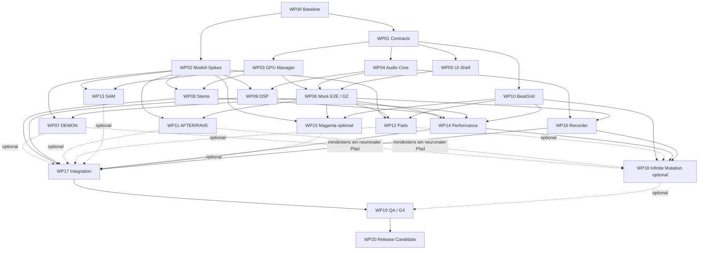

# SIRENS 2.0 – RTX Neural Music Playground

**Multi-Agenten-Implementierungsplan / zur Freigabe**  
Stand: 24.11.2026 · Ziel: Windows, NVIDIA RTX 5080 (16 GB VRAM), leistungsfähige CPU.  
Repository: https://github.com/ccogit/Sirens · geprüfter `main`: `90cc4a148ac6eed4c2f2512806f4af71c80dc649`.

Dieser Plan ist ein Arbeitsauftrag für die Entwicklung, keine Behauptung bereits implementierter oder auf der Zielhardware getesteter Funktionen. Die externe Modellkompatibilität, Lizenzen und Leistungsdaten werden in Machbarkeitsprüfungen verbindlich verifiziert. Keine Repository-Änderungen wurden für diesen Plan vorgenommen.

## 1. Ziel und verbindliche Leitplanken

- Lokales Live-Musiklabor für die interaktive Veränderung insbesondere elektronischer Musik: kontinuierliche KI-Transformation, taktquantisierte Neugenerierung, spektrale/granulare Effekte, Stems, Klang-Morphing, musikalische Automatisierung und Aufnahme.
- Bestehende Auftragsverwaltung, Claude-Starter, Katalog, Mastering, Auto-DJ, Kick-Tausch und Stem Studio funktionsfähig erhalten. Originaldateien nie überschreiben; keine Änderungen an Aufträgen ohne ausdrückliche Aktion.
- GPU aktiv einsetzen, aber Audiodeadlines, Klangqualität und Stabilität haben Vorrang vor Auslastungszahlen. CPU für zeitkritische Audio-I/O und leichtgewichtige DSP nutzen.
- Audiomaterial standardmäßig ausschließlich lokal; externe Modell-Downloads nur transparent und bewusst. Kein Cloud-Zwang. Code- und Gewichtslizenzen je Modell prüfen, keine nicht genehmigte Weiterverteilung.
- Die bisherigen Beschränkungen auf <400 Zeilen je Datei und externe Frontend-Quellen sind ausdrücklich aufgehoben. Tests hierzu dürfen zielgerichtet geändert werden. Andere Sicherheits- und Regressionstests bleiben bestehen. Neue Frameworks/Build-Systeme sind erlaubt, aber nur nach dokumentiertem Nutzen; kein unnötiger Rewrite.
- Neue Komponenten einzeln aktivierbar, unabhängig installierbar, mit klaren Fehlerzuständen und Dry-Fallback. Keine automatischen Modelle-Downloads beim Start. Nicht verfügbare Funktionen ehrlich deaktivieren; keine Attrappen als fertige KI verkaufen.
- Planungsannahme: zunächst Browser als alleinige Audio-Clock und Ausgabegerät; nativer WASAPI/ASIO-Host nur bei negativem Mess-Gate. Modellworker getrennt von Audio-Thread. WSL2 für Modelle nur wenn erforderlich; keine doppelte Audio-Clock.

## 2. Ist-Stand und Integrationspunkte

| Datei | Befund / Verwendung |
|---|---|
| `sirens/server.py` | ThreadingHTTPServer, App, GET/POST-Routing, Host/Origin- und JSON-Prüfung, bestehende CUDA-Sperre bei Claude. Realtime-Routing auslagern; kein blockierender Inferenz-Aufruf im Request-Thread. |
| `sirens/config.py`, `.env.example` | Konfiguration, Pfade und Feature-Flags ergänzen. Separate Worker-Interpreter. |
| `sirens/contracts.py` | `safe_audio_path`, `Ablehnung` wiederverwenden; zusätzliche sichere Cache-/Session-Pfade. |
| `sirens/stems.py`, `sirens/stem_notes.py` | Demucs-Subprozess, WAV-Cache und Notenerkennung; Adapter statt Bruch der vorhandenen API. |
| `sirens/beat.py`, `sirens/dramaturgie.py` | vorhandene Beat-/Downbeat-/Phrasenschätzung als Fallback und Eingang für Scheduler. |
| `web/js/live_lab.js`, `web/js/main.js` | Navigation, Spielzeug-Wechsel, Cleanup-Lifecycle; neue Suite registrieren. |
| `web/js/stem_audio.js`, `web/js/stem_synth.js` | gemeinsamer AudioContext, synchron gestartete BufferSourceNodes, Gain und Synth; Schnittstellen übernehmen/adapterieren, nicht unkoordiniert ändern. |
| `web/js/api.js` | bestehende API beibehalten; neue API in separatem Modul. |
| `tests/test_server.py`, `tests/test_web.py`, `.github/workflows/tests.yml` | Regression, CPU-/Mock-CI; lokale Windows-GPU-Suite zusätzlich. Aufgehobene Stilrestriktionen gezielt aus Tests entfernen. |

## 3. Agenten, Ownership und Git-Verfahren

A0 Lead/Integration; A1 GPU/Inference Runtime; A2 Realtime Audio/DSP; A3 generative Modelle; A4 Music Intelligence/Stems; A5 Sound Design; A6 UI; A7 Performance/Musiklogik; A8 QA/Sicherheit. A0 führt `integration/sirens-rt` und alleinige Freigabe/Merges. Pro WP Branch `feat/rt-wpXX-kurzname` vom jeweiligen freigegebenen Integrationsstand; Worktrees getrennt. Keine direkten Pushes auf `main`. Abhängige Arbeit darf mit festem Mock-Contract beginnen, aber erst nach Merge der Abhängigkeit integriert werden. Ein Agent darf mehrere WPs übernehmen; keine konkurrierenden Änderungen an gemeinsamem File. A0 allein ändert `server.py`, `config.py`, `.env.example`, gemeinsame Registries sowie finale README/CI; A6 allein ändert `live_lab.js`, `main.js` und gemeinsame CSS-Einstiege. Andere Agenten liefern Module und dokumentierte Integrations-Hooks. A8 besitzt Benchmark-Harness und QA-Berichte. Agenten verändern fremde Contracts nur via ADR und Freigabe A0.

Jeder WP liefert: Code, Tests, Installations-/Nutzungsdoku, verwendete Commit-/Versionspins, Lizenz- und Hardwareanforderungen, bekannte Grenzen, reproduzierbare Befehle, Akzeptanznachweis. PR-Text: WP, Depends-on, Änderungen, Tests, Hardwaremessung oder ausdrücklich 'nicht gemessen', Risiken, Rollback. Definition of Done: relevante Tests bestanden, dokumentierter Fallback, keine unbeabsichtigten Änderungen, Review A0/A8, Abnahmekriterien erfüllt. Fehlgeschlagenes Modellgate ist ein dokumentiertes Ergebnis, nicht 'implementiert'.

## 4. Architektur und eingefrorene Contracts (WP01)

Vorgeschlagene Modulstruktur:

```
sirens/realtime/    # stdlib-kompatibler Orchestrator, routes, sessions, assets
workers/           # separat installierte GPU-/KI-Worker, je Modellfamilie
native/            # optional SDK und WASAPI/ASIO, falls Messungen erforderlich
web/js/realtime/   # AudioWorklet, Transport, UI, Effektrack, Scheduler
docs/realtime/     # ADR, Contracts, Installations- und Nutzerhandbuch
tests/realtime/    # Mock-, Integrations-, Protokolltests
benchmarks/        # synthetische Fixtures, lokale Benchmark-Skripte
```

**Control plane:** gleiche Origin `/api/rt/v1/` über bestehenden Server, delegiert an `routes.py`. Kein Torch-Import in Sirens-Hauptprozess. `GET capabilities`, `GET gpu`, `POST sessions`, `GET sessions/{id}`, `POST sessions/{id}/commands`, `POST sessions/{id}/close`, `GET jobs/{id}`, `POST jobs/{id}/cancel`, `GET assets/{id}`. Commands: load/play/pause/seek/set_param/schedule/bypass. Session-ID servergeneriert, Sequenznummer und Epoch pro Transport-Generation. Status: `created → loading → ready → playing/paused → stopping → closed`, zusätzlich `error`. Jobs: `queued/running/ready/error/cancelled`. Fehler nach bestehendem `Ablehnung`-Muster, u.a. unavailable, busy_gpu, deadline_missed, stale_epoch. Jobs asynchron, Fortschritt sichtbar, kein HTTP-Warten auf Inferenz. Asset-IDs und Quellen serverseitig auf sichere Pfade auflösen. Keine frei ausführbaren Befehle oder benutzergesteuerten Worker-Pfade.

**Data plane:** dedizierter lokaler Sidecar mit versioniertem binären PCM-WebSocket, optional vom Hauptserver übergebenes kurzlebiges Session-Token; Browser verbindet ausschließlich Loopback, Origin- und Tokenprüfung, keine externen Clients, keine permissive CORS. Ports dynamisch/konfiguriert, Prozess vom Orchestrator überwacht. Wenn der ausgewählte Browser/Transport im Gate nicht stabil genug ist, Alternative als ADR beschließen. Kontrollnachrichten über HTTP, Audioblöcke binär, nicht Base64. PCM v1: Float32 LE, stereo interleaved, native Modellrate bekannt, Ausgabe 48 kHz als Standard (AudioContext tatsächliche Rate beachten), Resampling außerhalb Callback. Header: protocol_version, stream_id, epoch, seq, start_frame (uint64), nframes, channels, sample_rate, flags. Headergröße/Byteordnung in Schema festlegen. 256–2048 Frames pro Transportblock (Benchmark), AudioWorklet verarbeitet seine tatsächlich angeforderten Renderquanten; keine Annahme fester 128 Frames. Bounded queues, max lookahead, Backpressure, stale chunks bei Seek/Stop verwerfen. AudioWorklet liest Ringbuffer; initial MessagePort/Transferables, SharedArrayBuffer nur bei nachgewiesenem Vorteil und mit COOP/COEP-Tests. Keine Netzwerkaufrufe, Allokationen oder KI im Audio-Callback.

**Zeitbasis:** ein Master-Frame-Counter des AudioContext; Source-Position und Output-Frame unterscheiden, feste deklarierte Pfad-Latenz, Dry/Wet kompensieren, samplegenaue Start-/Loop-/Seek-Epochs. Scheduler quantisiert anhand BeatGrid (BPM, beat0/bar0, confidence, optional variable Tempo-Map). Bei geringer Konfidenz manuell korrigierbar; kein riskanter automatischer Übergang. Crossfade-Strategie per Pfad; kein generierter Chunk wird mitten in einer Phrase erzwungen.

**Model Registry / Adapter:** `probe`, `load`, `warmup`, `process` bzw. `generate`, `cancel`, `unload`, `health`; Capability-Descriptor mit `mode=streaming|lookahead|offline`, `sample_rates`, `channels`, `context_frames`, `hop_frames`, `latency_frames`, `controls`, `vram_peak_bytes` (gemessen oder unknown), `device`, `license`, `model_revision`. Versionierte JSON-Manifeste, reproduzierbare Lockfiles je Worker. Python-Worker über lokales IPC mit Heartbeat; keine Pickle-Daten aus untrusted Quellen. Modellspezifische Ausgaben normalisieren, nicht fälschlich mehrere Modi versprechen.

**GPU Manager:** NVML/`nvidia-smi` falls verfügbar, Prozess-Heartbeat, VRAM/Compute/Temperatur/Queue/Deadline-Telemetrie, Lease mit gemessener Peak-Reserve, kontrolliertes Entladen und Abbruch; Prioritäten Audio > vorberechneter nächster Abschnitt > Interaktion > Hintergrundjobs > Visuals. Sicherheitsreserve initial 2–3 GiB (konfigurierbar), nicht physisch reservierter VRAM. Vorhandene Claude-Sperre erst nach verifiziertem GPU-Manager umstellen; bei fehlender Telemetrie konservativ sperren. Kein unkontrolliertes Killen fremder Prozesse. Worker im eigenen Prozessbaum terminieren und Ressourcen freigeben.

**UI-Contract:** Toy-Lifecycle `mount/pause/destroy`; Kompatibilitätsadapter zur bisherigen Live-Lab-Logik. Dry/Wet, Bypass, Stop/Panic, Queue- und VRAM-Status, echte Modellverfügbarkeit, Latenzklasse, Qualitätsprofile. Keine simulierte KI als fertige Funktion. Audio-Zugriff nur nach Nutzerinteraktion.

## 5. Workpackages (vollständige Aufträge)

Aufwand = grobe Netto-Agenten-Arbeitstage (AT), nicht Kalendertage, keine Laufzeit- oder Liefergarantie. Gates können Aufwände verändern. `!` kennzeichnet ein Pflichtgate vor produktiver Freigabe. Alle WP-IDs sind stabil.

| WP | Owner | Abhängigkeiten (Merge/Gate) | Aufwand | Liefergegenstand |
|---|---|---|---|---|
| 00 | A0/A8 | – | 1–2 AT | Baseline, Worktrees, Fixture- und Testinventar |
| 01 | A0 | 00 | 2–3 | Architektur/Contracts, Versionierung, Mock |
| 02 | A1/A3/A5/A4 | 00 | 4–7 | Parallele Hardware-/Modell-Spikes, Gate G1 |
| 03 | A1 | 01 | 3–5 | GPU Manager, Worker Supervisor |
| 04 | A2 | 01 | 5–8 | Audio Core, IPC/Data plane, Transport/Clock |
| 05 | A6 | 01 | 3–5 | Live Lab Shell und Diagnose-UI |
| 06 | A0/A8 | 03,04,05 | 2–4 | Mock-End-to-End, Gate G2 |
| 07 | A3 | 02(DEMON),06 | 4–8 | DEMON Neural Remix Deck |
| 08 | A4 | 02(Separation),03 | 4–7 | Advanced Stem Studio / RoFormer / DrumSep |
| 09 | A2 | 02(SDK),04 | 5–9 | RTX DSP / Spectral / Granular / Convolution |
| 10 | A4 | 01 | 3–5 | Music Intelligence / BeatGrid / MIDI / Key |
| 11 | A5 | 02(RAVE/AFTER),06 | 5–9 | Neural Mutation / Audio Fusion |
| 12 | A3/A7 | 02(Stable Audio),06,10 | 5–9 | Generative Performance Pads |
| 13 | A4 | 02(SAM),03 | 3–6 | Semantic Stem Extractor |
| 14 | A7 | 06,08,09,10 | 5–9 | Drum Architect, Stem Crossover, Acid Transformer |
| 15 | A3 | 02(Magenta),06,10 | 3–7 | Generative Companion (optional) |
| 16 | A2/A6 | 04,06 | 3–5 | Recorder, Session Save/Replay, Export |
| 17 | A6/A0 | 07*,08,09,11*,12*,13*,14,15*,16 | 4–7 | Feature-Integration, Profiles, UX |
| 18 | A7 | 07* oder 11*,10,12*,14,16 | 3–5 | Infinite Mutation / automatisierte Performance |
| 19 | A8/A0 | 17,18* | 4–7 | Hardware-Soak, Regression, Release-Gate G4 |
| 20 | A0/A8 | 19 | 2–3 | Installer, Runbook, Release Candidate |

`*` = optional oder vom Modellgate abhängig. Bei negativem Gate ersetzt ein Abschlussbericht mit klarer Capability-Entscheidung die entsprechende Abhängigkeit; WP17/19 warten nicht endlos. WP18 braucht mindestens einen freigegebenen neuronalen Transformationspfad (07 oder 11), nicht zwingend beide; falls keiner vorhanden ist, klassische DSP-Mutation explizit als reduzierte Variante, WP18 optional. WP12/15/18 können keine nicht nachgewiesene Beat-Synchronität behaupten. WP09 kann bei negativem GPU-SDK-Gate mit CPU/WASM-Referenz weiterlaufen; GPU-Funktionen separat kennzeichnen. Die Modell-Spikes WP02 je Modell sind unabhängige Unterpakete; nach deren Ergebnis kann das betreffende WP beginnen, ohne alle anderen Spikes abzuwarten.

### WP00 – Baseline und Repository-Vorbereitung (A0/A8)
- Prüfe `git status`, pinne tatsächlichen `main`-SHA, erfasse Python/Node/ffmpeg/Driver/OS/WSL/VRAM/Audio-Gerät und freie Datenträgerkapazität. Keine lokalen uncommitted Änderungen überschreiben.
- Führe bestehende Tests aus (`py -3.11 -m unittest discover -s tests -v`), protokolliere Fehler vor Änderungen. Synthetische Impulse, Sinus, klickbasierte 120/140/150 BPM Testsignale sowie lizenzierte lokale Testtracks (Techno/House/Psytrance/Industrial/Ambient, keine Tracks ins Repo) definieren. Testmanifest enthält nur lokale Pfade und Hashes; synthetische Fixtures generierbar.
- Erzeuge Integrationsbranch, WP-Board, ADR-Vorlage, Benchmark-Ergebnisformat. Aufgehobene Zeilen-/External-Source-Tests zielgerichtet ändern und übrige Tests erhalten.
- Abnahme: Baselinebericht, reproduzierbare Testbefehle, Agenten-Ownership, kein Repository-Datenverlust.

### WP01 – Verträge und Architektur (A0)
- Erstelle `docs/realtime/{architecture,protocol,model-adapter,security}.md`, `sirens/realtime/contracts.py`, JSON-Schemas, Python/JS Mock-Adapter und Beispieldaten; entscheide Worker-/WebSocket-Transport und Feature-Flag `SIRENS_RT_ENABLED` (initial opt-in).
- Entscheide Zulassung von Native Host, Build-System nur per ADR. Pinne v1 API, Audioformat, Clock, Session-Lifecycle, Fehler, Cache-/Asset-Format, Adapter und Telemetrie. Entwickle minimale Mock-API/Fixtures für parallele Agenten.
- Abnahme: A1–A8 können unabhängig gegen Contracts entwickeln; Schema- und Contract-Tests in CPU-CI grün; Sign-off A0/A2/A8.

### WP02 – Hardware-/Modell-Spikes (A1 koordinierend; A3/A4/A5 parallel)
- Eigenständige, wegwerfbare Testumgebungen, keine Änderung an produktiver Sirens-Umgebung. Blackwell (`sm_120`), CUDA/PyTorch/TensorRT-Build, Treiber, FP16/FP8, ggf. WSL2; genaue Versionen und Installationsbefehle dokumentieren. Kein ungeprüftes Herunterladen/Ausführen von fremdem Code; Quellen, Hashes/Commit und Gewichte prüfen.
- Kandidaten je unabhängiger Bericht: DEMON (ACE-Step und kleinere Varianten); Stable Audio 3; Magenta RealTime 2; RAVE; AFTER; RoFormer/DrumSep; SAM Audio; GPU Audio SDK; optional alternative Streaming-Separation. Projekte/Links siehe Abschnitt 9. Nicht nur Import, sondern echte Inferenz mit eigenem Testaudio, Vergleich CPU/GPU, Peak-VRAM inkl. Treiber/Visuals, First-result, Chunk-RTF, Control-to-audio, Output-Latenz und subjektive Artefakte. Messung warm/kalt, Wiederholung und 10-minütiger Dauertest für Streaming; Generation über mehrere Seeds. Modell-Lizenz, Windows/WSL-Kompatibilität und tatsächlicher Modus protokollieren.
- Gate je Kandidat: `green` (geplanter Modus nachweisbar), `amber` (kleineres Modell/Lookahead/Offline statt Live), `red` (inkompatibel/kein akzeptabler Modus/Lizenzproblem). Bevorzugt RTX-native; WSL2 wenn stabil und loopback sicher; nicht auf fremde Hardware-Benchmarks verlassen. Kein Streaming-Label nur weil RTF <1.
- Abnahme: `benchmarks/results/` JSON + Markdown-Bericht pro Modell, konkrete Auswahl/Fallback und Pins; keine ungemessenen Zahlen als Erfolg. DEMON-Fehlschlag blockiert keine Basisentwicklung.

### WP03 – Ressourcenmanager & Worker Supervisor (A1)
- Implementiere `gpu_manager.py`, `worker_supervisor.py`, `model_registry.py`, `telemetry.py` und Profile (Eco, Performance, Neural, Training/Render). Persistente Worker, begrenzte Queues, Warm-up, Heartbeat, Timeout, Cancel, Prozessbaum-Cleanup, Admission-Control mit VRAM-Peak und Reserve. Kein Start großer Modelle ohne Nutzeraktion/Lease. Abhängigkeiten pro Worker getrennt, Startparameter allowlisten. Schutz vorhandener Produktion; A0 passt Legacy-CUDA-Policy erst nach Test an.
- Tests: Fake NVML, GPU unavailable, OOM, Crash, Cancel, Restart, konkurrierende Anfragen, externe GPU-Last. Abnahme: kein Audioverlust durch unkontrollierte GPU-Jobs, sauberer Busy-/Fallback-Zustand, keine verwaisten Worker, Telemetrie verfügbar ohne GPU.

### WP04 – Audio Core & Data Plane (A2)
- `web/js/realtime/{audio_core,clock,ringbuffer,transport,worklet_processor}.js`; dedizierter Sidecar, Audio-PCM-Protokoll und native Referenzpfade. Gemeinsame Clock, Multi-Stem-Mixer, Dry/Wet, Gain-Ramping, Seek-/Loop-Epoch, Scheduling, Latenzausgleich, Bypass, Limiter, Underrun-Zähler. Resampling vor Callback, Ringbuffer mit bounded queue, Drop/Crossfade bei Deadline. Bestehenden StemAudio-Player per Adapter anbinden; nur ein aktiver Ausgabepfad pro Suite.
- Test mit Impuls, zwei identischen Spuren, Phasen-/Sampleprüfung, variable Sample-Rate, Seek bei laufender KI, künstlichem Jitter, Worker-Absturz, Browser-Navigation. Abnahme: 30 Min. Mock-Playback ohne unerwartete Underruns; kompensierte Fixture-Abweichung <=1 Sample; keine NaN/Inf/Clipping im Referenzpfad; klickarmer Dry-Fallback. Tatsächliche Geräte-Latenz separat messen, Native Host nur nach ADR, wenn Browser-Gate verfehlt.

### WP05 – Live Lab Shell & GPU Dashboard (A6)
- `web/js/realtime/{shell,api,capabilities,gpu_panel,controls}.js`, eigene CSS. Neuer Bereich "RTX Neural Lab", Song-/Stem-Auswahl, Transport, Presets, A/B, Dry/Wet, Panic, Latenz-/GPU-Metriken, Installationshilfe, klare Moduslabels (Live / Lookahead / Offline). Modul-Lifecycle mit vorhandener Navigation, keine neuen GPU-Aufgaben beim bloßen Öffnen, keyboard- und optional MIDI-ready.
- Tests: Mock-Backend, disabled state, API-Fehler, Play/Stop, Navigation, leere Bibliothek, keine GPU. Abnahme: keine Fehler ohne KI, alle Zustände verständlich, kein doppelter AudioContext/Timer nach Verlassen.

### WP06 – Baseline-Integration / Mock Vertical Slice (A0/A8)
- Integriere WP03/04/05 per Feature-Flag, bestehende Host-/Origin- und Pfadprüfungen auf neue Routen erweitern. Echtes Testaudio über denselben Transport wie spätere Modelle durch einen deterministischen Gain/Delay-Mock verarbeiten, UI steuert Parameter. Mock explizit als Testmodus, nicht Nutzer-KI.
- Prüfe Session-Lifecycle, Nutzer-Stopp, Worker-Kill, Hot Reload, Backpressure, falsches Token, fremde Origin, Pfadtraversal, ungültiges PCM, oversized requests, stale epoch, OOM-Simulation. Kein Rückschreiben in Source-Dateien.
- Gate G2: 30 Min. stabil, Tests grün, End-to-End-Nachweis inklusive Dry-Fallback, keine Modellabhängigkeiten im Hauptprozess. Ohne G2 keine produktive KI-Integration.

### WP07 – DEMON Neural Remix Deck (A3)
- `workers/demon/`, Adapter, optional TensorRT-Engine-Build lokal, UI-Controls über Descriptor. Quellsong/Prompt, Style-Blend, Strength, Seed, verfügbare Parameter, Dry/Wet, A/B; Source- und Promptwechsel versionieren. Keine nicht vom Modell unterstützten Parameter vortäuschen. Streaming- vs Lookahead-Modus nach WP02; Delay korrekt kompensieren.
- Referenz-Demo außerhalb Sirens zuerst, dann Adapter, dann Session-Integration. Wenn 16 GB nicht reichen, kleineres Modell/Engine, begrenztes Profil oder Lookahead; bei endgültigem Red deaktivieren und alternativen RAVE/AFTER-Pfad nutzen.
- Abnahme: echter Audiooutput aus eigenem Song, mindestens 3 unterschiedliche hörbare kontrollierte Transformationen, 30 Min. ohne unerwartete Aussetzer im freigegebenen Profil, Quellenwechsel/Stop/Bypass, Messbericht. Bei Lookahead: rechtzeitige Insert-Quote und Fallback nach G3.

### WP08 – Advanced Stem Studio (A4)
- `workers/separation/`, `sirens/realtime/stem_adapter.py`, neue Registry für Demucs/RoFormer/DrumSep; Demucs-Kompatibilität erhalten. Modellabhängige Stem-Listen, zusätzliche Drum-Spuren nur wenn tatsächlich unterstützt, Cache-Key aus Quellhash/Modellrevision/Parametern, atomarer Publish, optional Parallel- oder Vorlaufverarbeitung. Kein 'Kick/Snare/Hi-Hat' versprechen ohne passendes Modell.
- A/B, Solo/Mute, Gain, Audioexport, Split-Qualität. Optional Streaming-Separation als eigenes Capability; ansonsten ehrlicher Vorbereitungsschritt.
- Abnahme: mindestens ein alternatives funktionsfähiges Modell oder dokumentiertes Red, korrekt ausgerichtete Stems und Wiederverwendung des Cache, Rekonstruktions-/Leakage-Bericht mit geeigneten Fixtures; Mix aller Stems transparent gegenüber Original (Abweichungen dokumentieren); fehlerfreier Rückfall auf Demucs.

### WP09 – RTX DSP Rack (A2)
- `native/gpu_dsp/` (falls GPU SDK geeignet), `web/js/realtime/effects/`; modulare CPU/WASM-Referenz und GPU-Backend. Reihenfolge: spektrales Freeze/Masking/Pitch (STFT/Overlap-Add); Granular Time Stretch/Cloud; partitionierte Faltung/IR-Morphing; optional Spatial/HRTF und neural analog rack. Parameter-Smoothing, Wet/Dry, Bypass, Limiter, Presets, FFT-/Grain-/IR-Profile.
- Benchmark identischer Signalpfade CPU vs GPU, Latenz inkl. Transfer, skalierende Anzahl paralleler Stems/Effekte. Keine GPU-Version übernehmen, wenn sie nur Last erzeugt und Deadlines verschlechtert.
- Abnahme: mindestens drei hörbar nutzbare Effektfamilien, automatisierte Signaltests (Impuls, Sinus, Stereo), keine NaN/Inf, kein Dropout im freigegebenen Profil; GPU-Speedup nur mit Nachweis, ansonsten CPU-Referenz als stabile Capability. Optional Spatial/Neural Analog nach Kernabnahme.

### WP10 – BeatGrid / Tonart / MIDI (A4)
- `sirens/realtime/music_analysis.py`, `web/js/realtime/beat_grid.js`; vorhandene `beat.py`/`dramaturgie.py` adaptieren. Modell-Option für Beat/Downbeat (z.B. Beat This! Live), Key/Chroma, Onsets, Pitch/MIDI via vorhandenes Basic Pitch und ggf. MuScriptor. Korrektur von Half/Double-Time, Downbeat, manuellem Tap und Phasenoffset; keine sichere Tonart bei geringer Konfidenz erfinden.
- Abnahme: synthetische 120/140/150 BPM Fixtures, Beat-/Downbeat-Toleranz <=20 ms nach Einrastphase als Ziel; reale Tracks mit manuell annotierten Referenzen, Messbericht statt Qualitätsbehauptung; Konfidenz, Korrektur und Fallback funktionieren. Einheitliches BeatGrid-Schema für alle Folgemodule.

### WP11 – Neural Mutation / Audio Fusion (A5)
- `workers/rave/`, `workers/after/`; pro Modell separat gated. Vortrainierte Modelle mit geprüfter Lizenz; RAVE-Latent-Controls, Morphing, Random-Walk im Takt, AFTER-Struktur-/Timbre-Referenzen, Wet/Dry. Streaming nur bei tatsächlich gemessener Modell-Latenz und Kontext; andere Pfade Lookahead/Offline.
- Abnahme: 3 verschiedene steuerbare Klangveränderungen je freigegebenem Modell, reproduzierbare Presets, 30 Min. Stabilität für Streaming, Latenzbericht; optional eigenes Training in einem separaten GPU-Profil, nicht parallel zum Live-Modus erzwingen.

### WP12 – Generative Performance Pads (A3/A7)
- A3: `workers/stable_audio/`, jobbasierter Generierungsadapter; A7: `web/js/realtime/pad_scheduler.js`. Vordefinierte musikalische Aktionen (Rise, Fill, Drop, Break, Bassline, Extend); Kontext/Prompt/Seed/Strength, 1/2/4/8 Takte, Jobdeadline, Candidate Preview, kontrollierter Insert. Inpainting/Fortsetzung nur wenn Modell tatsächlich unterstützt.
- Scheduler nutzt BeatGrid, Vorlauf aus gemessener p95-Renderzeit, resample/stretch bei Bedarf (Grenze + Warnung), Crossfade, automatische Verschiebung auf nächsten geeigneten Takt oder Dry-Fallback, niemals mitten in Phrase erzwingen. Optional DEMON-Backend nur nach WP07.
- Abnahme: >=3 Pad-Typen, 20 Testjobs mit dokumentierter Erfolgsquote; >=95% rechtzeitig im kalibrierten Profil als Ziel, sonst längerer Vorlauf/Offline-Label; synthetische Insert-Toleranz <=1 Sample, reale Abweichungen der erkannten Beats separat. Kein stilles Queue-Wachstum.

### WP13 – Semantic Stem Extractor (A4)
- `workers/sam_audio/`, Textprompt-Job, isolierte Quelle und Residual als neue Assets, Caching, Preview, Cancel und Dry. Unterstützte Modellgröße für 16 GB auswählen, optional kürzere Segmente/Offline. Keine automatische Internetübertragung von Musik.
- Abnahme: >=5 unterschiedliche Beschreibungen auf geeigneten lokalen Testtracks, qualitative Ergebnisse dokumentiert; Quell-/Residual-Alignment, Cancellation, keine falsche Garantie perfekter Isolation; Capability sichtbar nur bei installierter und freigegebener Version.

### WP14 – Musikbezogene Performance-Tools (A7)
- `web/js/realtime/{drum_architect,stem_crossover,acid_transformer}.js`, gemeinsame Scheduler- und Effekt-API. Drum Architect: Kick/Snare/Becken ersetzen/verdoppeln, Groove/Onsets und Velocity erhalten, manuelle Korrektur; bei fehlenden Drum-Stems nur vorhandene Spuren. Stem Crossover: aus bis zu 4 Songs wählen, Beat-/Key-Matching, begrenztes Stretching, Gain-Normalisierung, Konfliktwarnung, Quantisierung. Acid Transformer: aus Bass-MIDI oder Onsets resonanten Synth erzeugen; Akzente, Slides, Filter, Drive, Octave; vorhandene Bassspur optional ausblenden.
- Abnahme: drei reproduzierbare Demos je Tool, samplegenaue Fixture-Synchronität, keine unkontrollierte Lautstärke/Drift, Play/Stop/Seek, vollständige Presets. Kein Anspruch auf perfekte harmonische Automatik.

### WP15 – Generative Companion (A3, optional)
- `workers/magenta/`; lokaler Text/MIDI/Stilreferenz-Adapter, separate synchronisierte Begleitspur, Lautstärke/Style/MIDI-Steuerung. Kein Import aus externem Hauptprozess. Bei WSL-/GPU-Problemen kleineres Modell oder offline; keine behauptete Beatbindung ohne nachweisbare Synchronität.
- Abnahme: 10 Min. als zusätzliche Begleitspur, steuerbare hörbare Änderungen, Ressourcenbericht und kontrollierter Stop/Bypass. Sonst verschieben.

### WP16 – Recorder / Session Save & Export (A2/A6)
- `web/js/realtime/recorder.js`, `sirens/realtime/recordings.py`; verlustfreie PCM-Aufnahme im Master-Bus, begrenzte Buffer/Streaming auf Disk; WAV-Export (mind. 24-bit oder 32-bit float, dokumentiert), optional Stems, Session-JSON mit Quellenhashes, Modell-/Presetversionen, Timeline und Seeds. Für lange Aufnahmen Größenlimit/Segmentierung, Speicherplatzprüfung, atomare Finalisierung und Reparatur-/Recovery-Strategie. Kein MediaRecorder-Codec als 'verlustfrei' ausgeben. Nur Nutzeraktion startet Aufnahme.
- Abnahme: 30-Min.-Aufnahme (bei 48 kHz Stereo 24-bit ca. 518 MB), korrekte Dauer/Samplerate, Fixture-Samplevergleich innerhalb Quantisierungsgrenze, Stop/Crash/Datenträger-voll-Test; Export außerhalb Originalordner, Name kollisionsfrei. Session-Replay reproduziert Parameter, generative Modelle nicht zwingend bitidentisch; gerenderte Assets referenzieren.

### WP17 – Produktintegration und UX (A6/A0)
- Verknüpfe freigegebene Module in Live Lab, eigene Performance-Suite, Such-/Katalogzugriff, GPU-Profile, Preset-System, MIDI-Mapping optional, Panic-Stop, Parameter-Automation, klare Modell-/Moduskennzeichnung, Diagnose und Installation. Globale GPU-Policy mit bestehendem Claude-Status und Visual-Profil verbinden. A0 prüft, welche Features tatsächlich freigegeben wurden; optional deaktivierte Modelle blockieren den Release nicht.
- Abnahme: durchgehende Nutzerflüsse (Song laden, Stems wählen, Effekt/KI aktivieren, Pad auslösen, aufnehmen, exportieren, stoppen), keine versteckten Auto-Downloads, keine Leaks oder Doppelaudio; bestehende Navigation/Produktion funktionsfähig. Gate G3 je Feature vor Aufnahme in Release.

### WP18 – Infinite Mutation / Performance Automation (A7, optional)
- `web/js/realtime/mutation_scheduler.js`; 4/8/16-Takt-Automation für kontrollierte Latent-/DSP-Veränderung, Intensität, Wiederholbarkeit, Energy-Regie, manuelle Override, Rückkehr zum Original, Grenzen für Loudness/Queue/Modellwechsel. Kombiniere nur freigegebene Backends. Keine endlose Asset-Erzeugung ohne Quota; Session- und Seed-Protokoll.
- Abnahme: 30 Min. evolvierender Mix, mindestens 3 Szenarien, Nutzer kann jederzeit stoppen/Original hören; keine Deadlines durch Hintergrundautomation, keine ungeprüften Modellwechsel. Bei fehlendem neuronalen Pfad reduzierten DSP-Modus ausdrücklich kennzeichnen oder Paket verschieben.

### WP19 – Systemabnahme / Reliability (A8/A0)
- CPU-CI (unittest + rekursive Node-/Browser-Tests, keine Modellgewichte), Windows-Hardware-Suite, synthetische Audio-Protokolltests, lokale reale Hörtests. Test GPU-Engpass, OOM, Worker-Crash, Disconnect, Seek, Hintergrundtab, Gerätewechsel, Claude-Start, laufende Produktion, Platte voll, ungültige Pfade, Origin/Token. Prüfe keine Originaländerung und keine verwaisten Prozessbäume. Hardware-Matrix pro Feature/Profil, reproduzierbarer Report.
- 2h Soak-Test des stabilen Performance-Profils, mindestens 30 min je freigegebenem Streaming-Modell. Lookahead/Offline getrennt testen. Gate G4 nach Abschnitt 7; wenn einzelne Modelle verfehlen, deaktivieren statt ganze Suite blockieren. Keine Release-Freigabe bei Fehlern in Kernpfad/Sicherheit/Bestandsworkflow.

### WP20 – Rollout, Installation, Runbook (A0/A8)
- Opt-in Windows-Installer/PowerShell-Skripte pro Worker, pinned Versions/Hashes, Treiber-/CUDA-Diagnose, Speicherplatz-/VRAM-Check, Modell-Download mit Zustimmung, keine globale Python-Veränderung, Deinstallation/Feature-Flag-Rollback. Reproduzierbare Installationsanleitung, Lizenzmatrix, Troubleshooting, Nutzerhandbuch mit tatsächlichen Modi/Latenzen.
- Release Candidate erst nach G4, Tags/Changelog, keine Veröffentlichung ohne Freigabe des Repo-Owners. Abnahme: frische Testinstallation oder sauber dokumentierter reproduzierbarer Installationslauf auf Zielsystem; Legacy-Betrieb auch bei fehlender KI; Rückfall per Flag und getrennte Cache-Daten.

## 6. Abhängigkeitsgraph und Ausführungswellen



Arbeitswellen (kein fixes Kalenderversprechen):
- Welle 0: WP00. Welle 1: WP01 und WP02 parallel (Spikes je Modell unabhängig).
- Welle 2: WP03/04/05/10 nach Contracts parallel, laufende WP02-Spikes. WP08/09/13 können starten, sobald ihre Teil-Gates und Basisabhängigkeiten erfüllt sind.
- Welle 3: WP06 als Kern-Gate; WP07/11/12/15/16 nach jeweiligen Dependencies. WP14 nach Stems/DSP/BeatGrid. GPU-Zeit exklusiv reservieren, CPU-Entwicklung parallel.
- Welle 4: WP17 Integration und WP18 optional parallel soweit unabhängige Dateien. Feature-Gates G3.
- Welle 5: WP19 und danach WP20. Kritischer Kernpfad WP00→01→04→06→16→17→19→20; WP08/09/14 bzw. Modell-Gates können tatsächlich länger sein. Kein starres kritisches Pfadversprechen ohne gemessene Dauer.

Release-Staffelung: R0 Foundation (G2, kein echtes KI-Versprechen); R1 MVP (Advanced Stems, 3 DSP-Effektfamilien, Recorder, mindestens ein erfolgreiches neuronales Modul wenn vorhanden; sonst ausdrücklich GPU-DSP/Stem-MVP); R2 Generative Performance (Pads, Crossover, Semantic, weitere neuronale Pfade); R3 optional Companion/Infinite Mutation/Training. Teil-Releases nur nach relevantem QA-Gate und Freigabe.

## 7. Gates und messbare Systemziele

Die folgenden Zahlen sind **Abnahmeziele**, keine Messwerte der RTX 5080. Modelle und Audiogeräte bestimmen die tatsächlich erreichbaren Werte. Maße: p50/p95/p99, warm/cold, Peak-VRAM (gesamte GPU und Worker), RTF = Inferenzzeit / erzeugte Audiodauer, Dropouts/Underruns, CPU/GPU, RAM, Latenzkompensation, thermisches Verhalten. Audio-Latenz vom Signal/Steuerereignis bis zur hörbaren Ausgabe messen, nicht lediglich Kernelzeit. Realtime-Throughput reicht allein nicht für niedrige Latenz.

| Gate / Metrik | Ziel / Konsequenz |
|---|---|
| G1 Modell-Spike | Verifizierte Installation + tatsächliche Ausgabe + Lizenz + Modus; grün/amber/rot pro Modell. |
| G2 Core | 30 min deterministischer E2E-Mock ohne unerwartete Underruns; Fixture-Alignment <=1 Sample; Dry-Fallback; CPU-CI grün. |
| G3 Fast DSP | Zusatzlatenz als Ziel <=20 ms bei Standardprofil; p95 Control-to-audio <=50 ms; wenn verfehlt, optimieren oder als höherlatenten Effekt kennzeichnen. FFT-/Lookahead-Effekte können höhere deklarierte Latenz haben. |
| G3 Neural streaming | Ziel RTF p95 <=0,8 (gemessen je relevanter Chunk, Pipeline und Hardwarelast), Control-to-audio p95 <=250 ms für unmittelbare Klangsteuerung; bewusst gepufferte Modi separat kennzeichnen. 30 min ohne unerwartete Dropouts. Bei Überschreitung Lookahead statt Streaming. |
| G3 Lookahead | >=95% rechtzeitig bei 20+ Jobs im gemessenen Vorlaufprofil; verspätete Jobs werden verschoben oder verworfen, nicht erzwungen. |
| G3 VRAM | Initial mindestens 2–3 GiB freie Reserve unter normaler Last als Planungsziel; tatsächliche Verfügbarkeit messen; OOM/externen Lastwechsel kontrolliert behandeln. |
| G3 Audio-Sicherheit | Kein NaN/Inf; konfigurierbarer Schutzlimiter, initial Output-Peak <= -1 dBFS (True Peak nur bei entsprechender Messung); Gain-Matched A/B. |
| G4 Release | 2h Performance-Soak ohne unerwartete Audioaussetzer im Standardprofil, Regression grün, keine unkontrollierten Worker, keine Source-Änderung, dokumentierte Modellgrenzen/Installationen. |

Bewusste Fallback-Injektionen zählen separat, dürfen aber keinen unkontrollierten Aussetzer erzeugen. Unter Windows WDDM externe VRAM-Belegung/OS-Reserve berücksichtigen. Temperatur/Power-Limit nicht künstlich erzwingen. Große Modelle nicht gleichzeitig resident halten, sofern nicht gemessen stabil. Visualisierung im Neural-Profil zuerst drosseln; kleine DSP-Aufgaben bei CPU-Vorteil dort lassen.

## 8. Erster ausführbarer Auftrag an den Orchestrator

> Du bist A0, Lead Architect des Repositories `ccogit/Sirens`. Implementiere zunächst ausschließlich WP00/WP01 und koordiniere unabhängige WP02-Spikes. Prüfe den aktuellen Commit gegen den im Plan genannten Stand, übernimm bestehende lokale Änderungen nicht ungefragt, erstelle einen Integrationsbranch. Die Beschränkungen auf 400 Zeilen und externe Frontend-Quellen wurden aufgehoben; übrige Sicherheits- und Regressionstests erhalten. Stelle verbindliche versionierte Audio-/API-/Worker-Contracts mit Fake-Backend bereit. Beauftrage A1–A8 gemäß WP-Tabelle. GPU-Inferenz und Audioausgabe sind entkoppelt; primärer Host zunächst Browser. Keine echten Modell-Implementierungen als fertig bezeichnen, bevor das jeweilige Gate bestanden ist. Plane GPU-Hardware-Slots exklusiv und nutze CPU-/Mock-Tests parallel. Melde pro WP Status, konkrete Commit-/PR-IDs, Testergebnisse, Messdaten, verbleibende Blocker und Capability-Entscheidung. Keine direkten Commits auf main, kein Release ohne Freigabe.

Agentenstatus als `queued|in_progress|blocked|review|done|deferred`, mit `wp`, `owner`, `depends_on`, `branch`, `commit`, `tests`, `gate`, `blockers`, `next_action`. A0 aktualisiert Board beim Merge/Capability-Wechsel, nicht durch bloße Schätzungen. Kein Agent nimmt Arbeit eines anderen WPs ungefragt vorweg. Bei gemeinsamem Blocker dokumentieren, ADR/Contract-Änderung an A0 eskalieren, unabhängige Pakete weiterführen.

## 9. Kandidatenliste für die Machbarkeitsprüfung (keine Verfügbarkeitsgarantie)

- DEMON: https://github.com/daydreamlive/DEMON
- Stable Audio 3: https://github.com/Stability-AI/stable-audio-3
- Google Magenta RealTime: https://github.com/magenta/magenta-realtime
- RAVE: https://github.com/acids-ircam/RAVE
- AFTER: https://github.com/acids-ircam/AFTER
- GPU Audio SDK: https://github.com/gpuaudio/gpuaudio-sdk
- SAM Audio: https://github.com/facebookresearch/sam-audio
- Stem-Modelle: https://github.com/ZFTurbo/Music-Source-Separation-Training ; https://github.com/pymss-project/pymss
- Beat This! Live: https://github.com/CPJKU/beat_this_live ; Signalsmith Stretch: https://github.com/Signalsmith-Audio/signalsmith-stretch
- Optional: MuScriptor, Neural Amp Modeler, weitere Streaming-Stem-Modelle. Agent prüft genaue Version, Code/Gewichtslizenz, Windows/WSL2, benötigte Schnittstellen und GPU-Messwerte vor Auswahl. Ein veralteter oder nicht erreichbarer Link ist ein Spike-Blocker, keine Erlaubnis, Ergebnisse zu erfinden.

## 10. Offene Entscheidungen und Grenzen

- Kein Zugriff auf tatsächlichen Rechner/RTX für diesen Plan, keine Tests auf der Zielhardware durchgeführt. Alle Leistungswerte sind Ziele; WP02/G3 entscheiden.
- Vollständige Modellintegration (insbesondere DEMON, Magenta, SAM Audio) ist von Windows/WSL2, VRAM, Lizenzen und tatsächlichem Streaming-API abhängig. Falls nötig alternative Backends oder Lookahead-Modi statt falscher Echtzeitversprechen.
- Browser-first, getrennte Worker, v1-Contracts, optionaler Sidecar und agentenweise Ownership sind vorgeschlagene Architekturentscheidungen, keine bereits implementierte Infrastruktur. Native Audio-Ausgabe nach Mess-Gate; GPU-SDK nur nach belegtem Vorteil.
- Arbeitsumfang ist bewusst modular. Der User kann nach MVP jede weitere Phase freigeben, ohne die Basis neu zu entwickeln. Für lokale Hardwaremessungen muss ein Agent auf dem Zielrechner oder einer gleichwertigen Testumgebung laufen.
